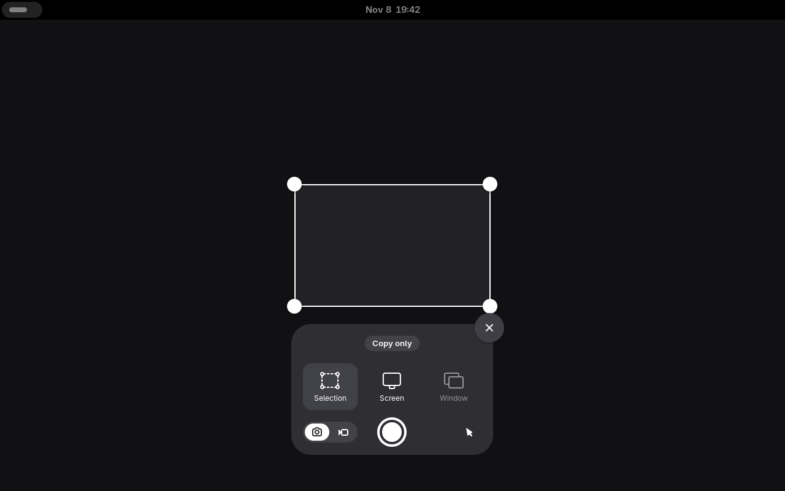

# Screenshot Copy Only

Copy screenshots without saving a file, using GNOME’s native screenshot overlay.

Press **Ctrl + Print Screen**, choose **Selection**, **Screen** or **Window**,
then press **Enter** or click the capture button. A small **Copy only** indicator
shows that the image will go straight to your clipboard. Release Ctrl after
opening the overlay.

**Print Screen** keeps GNOME’s normal save-and-copy behavior. **Escape** cancels
and resets the mode. Screen recordings and portal screenshots retain their
normal behavior.



## Compatibility

Supports **GNOME Shell 51**. The original local extension was tested on
**Fedora Workstation 45, GNOME Shell 51.1, Wayland**. Other major GNOME releases
are not currently supported. Compatibility depends on GNOME Shell’s private
screenshot methods and must be checked for each new major release.

## Install

Download the `.shell-extension.zip` from the
[latest GitHub release](https://github.com/RobCalDev/screenshot-copy-only/releases/latest),
then run from the download directory:

```sh
gnome-extensions install screenshot-copy-only@robcaldev.github.io.shell-extension.zip
```

Log out and back in once, then enable it:

```sh
gnome-extensions enable screenshot-copy-only@robcaldev.github.io
```

GNOME on Wayland discovers new local extensions at login. The GNOME Extensions
website listing is pending; GitHub releases are the current distribution channel.

If you used the original development copy, first disable it:

```sh
gnome-extensions disable screenshot-copy-only@local
```

Keep only one copy enabled; both register Ctrl + Print Screen.

### Install from source

Clone this repository and run `bash install.sh`, then log out and back in once.
The source installer needs Python 3, PyGObject and `glib-compile-schemas` and
preserves your other enabled extensions. These are available in the Fedora
Workstation environment used for development. The ZIP installation needs no
Python or Node.js at runtime.

## Disable

```sh
gnome-extensions disable screenshot-copy-only@robcaldev.github.io
```

Disabling removes the shortcut and indicator and restores the original screenshot
methods. To remove the installed extension after disabling it:

```sh
gnome-extensions uninstall screenshot-copy-only@robcaldev.github.io
```

## What gets saved?

The copy-only capture path encodes the screenshot into a memory stream and puts
its PNG bytes into GNOME’s clipboard. It does not create a screenshot file or
save one and delete it afterward. It does not change GNOME’s global save policy.
Clipboard history software may independently retain copied images.

## Development

Run `make check` for JavaScript syntax checks, six behavior tests, schema
validation, installer syntax validation and a packaging test. Run `make pack`
to create a deterministic runtime ZIP and SHA-256 checksum in `dist/`.

Node.js 24, Python 3, Make and GLib’s `glib-compile-schemas` are needed for these
checks. No third-party JavaScript or Python packages are required. Automated
behavior tests use fake desktop services; manual capture checks are described
in the [maintainer guide](docs/MAINTAINING.md).

Please report bugs through
[GitHub Issues](https://github.com/RobCalDev/screenshot-copy-only/issues).
See [CONTRIBUTING.md](CONTRIBUTING.md) for useful details to include.

## License and attribution

[GPL-2.0-or-later](LICENSE). The capture geometry and memory compositing are
adapted from GNOME Shell’s screenshot implementation; see [NOTICE](NOTICE).
Development used AI assistance. The maintainer is responsible for reviewing,
testing and maintaining public releases. This is an independent project.
